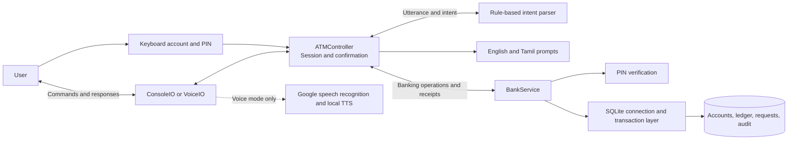
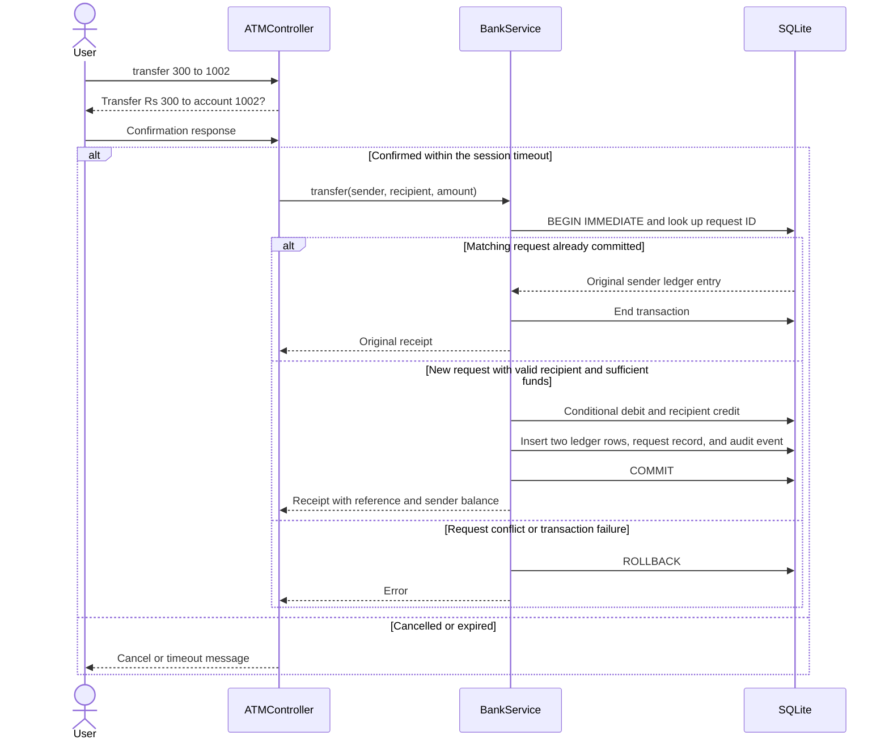
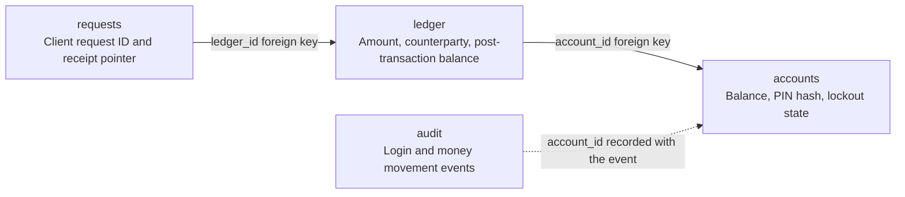

# Voice-Aided ATM Simulator

A local Python and SQLite ATM simulator with English and Tamil commands. Users sign in with a keyboard-entered PIN, check their balance, withdraw funds, transfer funds between demo accounts, and view recent transactions. The same banking logic runs behind a terminal interface and an optional microphone interface.

The central engineering problem is keeping balances and transaction history consistent when a transfer fails, two withdrawals compete for the same funds, or a caller retries after losing a response.

## Run the demo

Text mode requires Python 3.9+ and uses the standard library. Start with a fresh database filename to reproduce the balances below.

```bash
python3 main.py --db ./interview-demo.sqlite3 --seed-demo --language en
```

| Demo account | PIN | Initial balance |
| --- | --- | ---: |
| 1001 | 1234 | Rs 50,000 |
| 1002 | 5678 | Rs 15,000 |

1. Sign in as `1001`. Enter `transfer 300 to 1002` and answer `no`. Run `balance` to verify Rs 50,000.
2. Repeat the transfer and answer `yes`. The receipt shows Rs 49,700. Use `history` to see the outgoing transfer, then enter `exit`.
3. Reopen the same database with `python3 main.py --db ./interview-demo.sqlite3 --language ta`. Sign in as `1002`. Use `இருப்பு` for the balance of Rs 15,300 and `பரிவர்த்தனை` for the incoming transfer.

Try `withdraw 500` for a withdrawal. Tamil equivalents include `பணம் எடு 500` (withdraw), `அனுப்பு 300 1002` (transfer), `ஆம்` / `இல்லை` (yes / no), and `வெளியேறு` (exit). Seeding adds missing demo accounts and preserves existing balances and lockouts.

## System architecture



| Layer | Responsibility | Code |
| --- | --- | --- |
| Entry point | Parses flags, initializes the database, and selects the I/O adapter. | [main.py](main.py) |
| I/O and language | Reads text or speech commands and formats supported prompts in English or Tamil. | [io.py](atm/io.py), [i18n.py](atm/i18n.py) |
| Parser and controller | Matches complete commands, collects missing inputs, and confirms monetary actions within an authenticated session. | [nlp.py](atm/nlp.py), [controller.py](atm/controller.py) |
| Banking and PIN verification | Validates business rules, handles PIN lockout, writes transactions, and replays receipts. | [services.py](atm/services.py), [security.py](atm/security.py) |
| Persistence | Defines the schema, enables SQLite WAL and foreign-key enforcement, and owns commit and rollback. | [storage.py](atm/storage.py) |

## What happens during a transfer



- **Atomicity and concurrency.** The debit includes a sufficient-balance condition in the SQL update. `BEGIN IMMEDIATE` makes writes take turns, so a second withdrawal checks the updated balance. If a later transfer write fails, SQLite rolls back the debit, credit, and any rows already written in that transaction.
- **Idempotency.** A shared request ID identifies a committed withdrawal or transfer. A retry compares the operation, source account, amount, and destination against the saved ledger entry. Matching inputs return the original receipt, including the balance immediately after the original operation. Different inputs raise a conflict. The service caller must reuse the ID for a retry. Every newly confirmed CLI command gets a fresh ID.
- **Money and validation.** The CLI accepts whole rupees and the service stores integer paise for exact arithmetic. The service caps each withdrawal or transfer at Rs 10,000, requires withdrawals in Rs 100 increments, and rejects transfers to the same account. The parser rejects partial matches such as `withdraw -500` or `withdraw 500.5`.

## SQLite data model



| Table | What to look for |
| --- | --- |
| `accounts` | Account ID is the primary key. A check constraint protects the non-negative balance invariant. |
| `ledger` | Withdrawals write one row. Transfers write an outgoing row and an incoming row. The `(account_id, id DESC)` index supports recent-history reads. |
| `requests` | The request ID is the primary key and points to the receipt's ledger row. For a transfer, the pointer uses the outgoing row. |
| `audit` | Events record successful logins, failed PIN attempts for known unlocked accounts, and successful money movements. |

Startup uses SQLite's `user_version` to upgrade older databases. It backfills request IDs from existing ledger rows and uses the earliest receipt when legacy operations share an ID.

## Authentication and session behavior

PINs are entered with `getpass` and stored as salted PBKDF2-SHA256 hashes. Verification compares digests with `hmac.compare_digest`. Three consecutive incorrect PINs lock the account, and a successful login resets the failed-attempt counter. Failed attempts are committed before the authentication error is raised.

The controller binds commands to the signed-in account for the duration of the CLI session. It uses a monotonic clock and checks the 180-second idle deadline before and after each interactive prompt. A blocking prompt can outlast the deadline, but its late response is discarded.

## Tests an interviewer can run

```bash
python3 -m unittest discover -s tests -v
```

| Scenario | What the test verifies |
| --- | --- |
| Concurrent withdrawals | Three Rs 10,000 withdrawals compete for Rs 15,000. Exactly one succeeds, leaving Rs 5,000. |
| Transfer rollback | A SQLite trigger rejects the incoming ledger insert after both balance updates. Both balances, histories, the request table, and the audit table roll back. The transfer can then be retried. |
| Idempotency and migration | Repeated requests preserve balances, cross-operation key reuse is rejected, and a legacy transfer replays after migration. |
| Confirmation and parsing | Cancellation and expired confirmation skip the banking operation. A confirmed Tamil command passes the expected source, recipient, and amount. Malformed amounts are rejected. |

See [service tests](tests/test_services.py) and [controller tests](tests/test_controller.py).

## Optional voice mode and project scope

```bash
python3 -m pip install -r requirements-voice.txt
python3 main.py --db ./interview-demo.sqlite3 --mode voice --language en
```

SpeechRecognition sends microphone audio to Google's recognition endpoint. `pyttsx3` handles speech output, and Tamil playback depends on the voices installed on the machine. Recognition errors can fall back to keyboard input. The command parser uses a small English and Tamil grammar. Service error messages are in English, and text mode is the verified demo path.

This project models banking operations with demo data on one machine. Authentication is enforced by the CLI controller and the service trusts its local caller. SQLite's single-writer model suits the local workload. A deployed system would need service-side authorization and integrations for banking and physical ATM hardware.

For a short introduction and practice questions, see the [interview guide](INTERVIEW.md).
